<h1 align="center">Hey, I'm Serkan Korkut</h1>

  <b>Software Engineer · Backend Engineer at Mapa Global</b> 
  İstanbul, Türkiye

  

  
  

---

### About me

- Working as a **Software Engineer / Backend Engineer** at **Mapa Global**.
- I mostly work on the **backend**: designing APIs, services and database integrations.
- Building services with **Spring Boot** and **.NET**, working with **SQL Server**, **Oracle** and **Docker**.
- On the frontend side I'm comfortable with **React** and **Next.js**.

### Tech stack

  

---

  

  

Backend first, one commit at a time.

